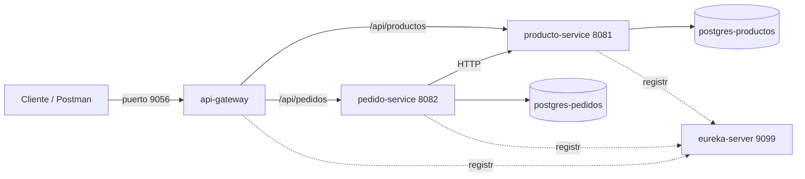
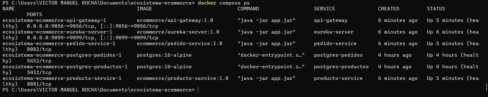
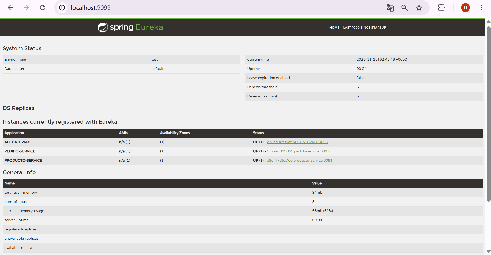

# Ecosistema E-commerce con Docker


Microservicios Spring Boot (producto y pedido) con PostgreSQL, Eureka y API Gateway, empaquetados con Docker y levantados con un solo comando. Material de la Semana 15 / Taller 4 de Electiva I.


## Arquitectura





| Servicio | Puerto interno | Publicado al equipo | Descripción |

|---|---|---|---|

| api-gateway | 9056 | Sí (entrada única) | Enruta hacia producto y pedido usando Eureka |

| eureka-server | 9099 | Sí (panel) | Registro de servicios |

| producto-service | 8081 | No | CRUD de productos, usa postgres-productos |

| pedido-service | 8082 | No | Crea pedidos consultando a producto-service, usa postgres-pedidos |

| postgres-productos / postgres-pedidos | 5432 | No | Bases de datos con volumen con nombre |


## Requisitos


- Docker Desktop (o Docker Engine) con Docker Compose v2 o superior

- Git

- 8 GB de RAM como mínimo


No se necesita Java ni Maven en el equipo: la compilación ocurre dentro de Docker (Dockerfile multi-stage).


## Despliegue


1. Clonar el repositorio y entrar a la carpeta:


  ```

  git clone https://github.com/universidad041020-ops/ecosistema-ecommerce.git

  cd ecosistema-ecommerce

  ```


2. Crear el archivo de credenciales a partir del ejemplo (el `.env` no se versiona):


  ```

  copy .env.example .env

  ```


  En Linux o macOS: `cp .env.example .env`. Se pueden cambiar el usuario y la clave de la base de datos.


3. Construir y levantar todo:


  ```

  docker compose up -d --build

  ```


4. Verificar que los seis contenedores estén en `healthy` (puede tardar un par de minutos la primera vez):


  ```

  docker compose ps

  ```





El panel de Eureka está en http://localhost:9099 y debe mostrar los tres servicios en `UP`:





## Ejemplos de uso


Todas las peticiones entran por el Gateway (puerto 9056).


Crear un producto:


```

curl -X POST http://localhost:9056/api/productos -H "Content-Type: application/json" -d "{\"nombre\":\"Laptop\",\"precio\":2500000,\"stock\":10}"

```


Listar productos y consultar uno por id:


```

curl http://localhost:9056/api/productos

curl http://localhost:9056/api/productos/1

```


Crear un pedido (el total se calcula con el precio del producto):


```

curl -X POST "http://localhost:9056/api/pedidos?productoId=1&cantidad=2"

```


En PowerShell se puede usar `Invoke-RestMethod` en lugar de `curl`. La colección de Postman está en la carpeta `postman`.


## Comandos útiles


| Comando | Para qué sirve |

|---|---|

| `docker compose up -d --build` | Construye las imágenes y arranca todo |

| `docker compose ps` | Estado y salud de cada contenedor |

| `docker compose logs -f producto-service` | Sigue los logs de un servicio |

| `docker compose down` | Detiene y elimina contenedores y red; conserva los datos |

| `docker compose down -v` | Igual, pero también borra los volúmenes y sus datos |


## Estructura del repositorio


```

ecosistema-ecommerce/

├── docker-compose.yml

├── .env.example

├── docs/                 capturas de evidencia

├── api-gateway/          Dockerfile

├── eureka-server/        Dockerfile

├── producto-service/     Dockerfile

└── pedido-service/       Dockerfile

```


